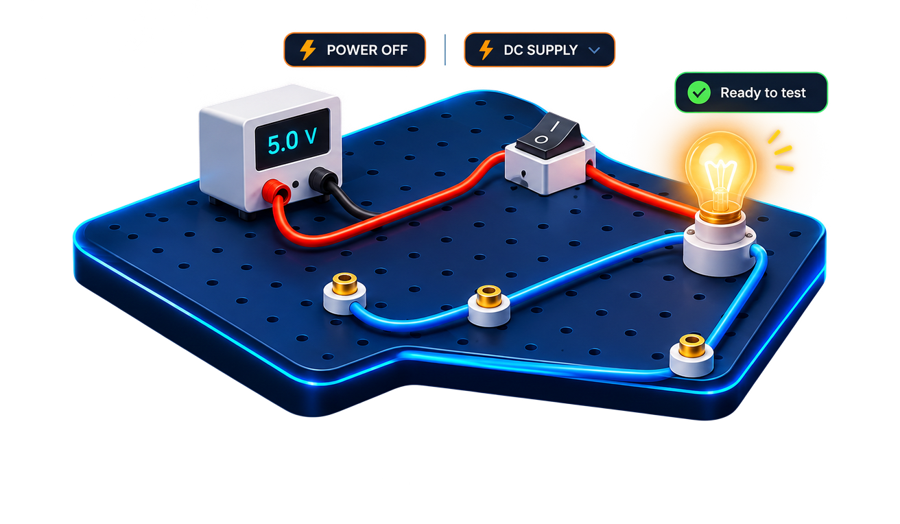

# CircuitSim Website Testing Summary

## Testing Methodology
- Code review of all three project files: `index.html`, `style.css`, `script.js`
- JavaScript syntax validation not possible (Node.js not available in environment)
- Local Python HTTP server attempted (`python -m http.server 8000`) but browser could not be launched from this environment
- Analysis performed on CSS rules, HTML structure, and JavaScript logic

## Critical Bugs & UI Positioning Issues Found

### 1. Hero Visual Negative Margins (style.css:975)
```css
.hero-visual {
  min-width: 0;
  margin: -3px -3vw -10px -18px;  /* ⚠️ Causes horizontal overflow on mobile */
}
```
- **Issue**: Negative left/right margins cause the hero image/section to overflow horizontally on narrow viewports
- **Impact**: Horizontal scrollbars appear on mobile devices, degraded user experience
- **Fix**: Remove negative margins or use `overflow: hidden` on the parent hero container

### 2. Fixed 5-Column Navigation Grid (style.css:352)
```css
nav {
  grid-template-columns: repeat(5, minmax(0, 1fr));  /* ⚠️ Fixed 5 columns */
  overflow-x: auto;
}
```
- **Issue**: Navigation uses fixed 5-column grid that doesn't adapt to narrower screens
- **Impact**: Horizontal scrolling on devices under 52rem (832px), poor mobile UX
- **Fix**: Make navigation responsive: 5 columns > 52rem, 3 columns 40-52rem, 2 columns < 40rem, 1 column < 30rem

### 3. "how" Disclosure Not Responsive to Resize (script.js:2074)
```javascript
$("how").open = matchMedia("(min-width:52rem)").matches;
```
- **Issue**: Sets initial disclosure state but has no resize event listener
- **Impact**: If user rotates device or resizes browser, disclosure state doesn't update
- **Fix**: Add `window.addEventListener('resize', ...)` to update disclosure state

### 4. Inconsistent Navigation Button Padding
- Home page: `padding: 8px 14px` (style.css:94)
- Activity menu: `padding: 5px 2px` (style.css:359)
- App screen: `padding: 9px 10px` (style.css:1495)
- **Issue**: Different button sizes across pages create inconsistent UI
- **Impact**: Uneven touch targets, visual inconsistency when navigating between pages
- **Fix**: Standardize button padding to one value (recommend 8px 14px for consistency with homepage)

### 5. Activity Grid Column Count (style.css:1352)
```css
#menu .activity-grid {
  grid-template-columns: repeat(3, minmax(0, 1fr));  /* 3 columns desktop */
}
```
- **Issue**: Fixed 3-column grid on desktop, responsive transitions not fully tested
- **Impact**: Awkward intermediate states at breakpoint boundaries
- **Fix**: Add explicit rules for column counts at each breakpoint range

### 6. Hero CTA Max-Width Constraint (style.css:458)
```css
#start {
  max-width: 320px;  /* ⚠️ Too constrained on desktop */
}
```
- **Issue**: "Start learning" button max-width is 320px
- **Impact**: Button looks overly constrained on wider desktop layouts
- **Fix**: Increase max-width for desktop or remove constraint and let it be fluid

### 7. Hero Image Fixed HTML Dimensions (index.html:42)
```html

```
- **Issue**: Fixed HTML dimensions (1643×957) despite CSS `width: 100%; height: auto;`
- **Impact**: Potential Cumulative Layout Shift (CLS), poor scaling on different aspect ratios
- **Fix**: Remove width/height attributes, let CSS handle sizing, or use `srcset` for different sizes

### 8. 3D Canvas Responsive Z-Index Layering (style.css:1667-1676)
- **Issue**: `min-height: 420px` doesn't adapt downward on mobile, z-index transitions between 2D/3D views
- **Impact**: Possible clipping or overlapping at certain viewport widths during view switches
- **Fix**: Make 3D container height responsive, test 2D↔3D transitions at all breakpoints

### 9. Tools Grid Column Inconsistency (style.css:1870-1874)
```css
#app .tools {
  grid-template-columns: repeat(4, minmax(0, 1fr));  /* 4 columns desktop */
}
```
- **Issue**: 4 columns on desktop, responsive rules only for ≤900px (2 columns) and ≤560px (2 columns)
- **Impact**: No explicit rule for 900px-1440px range, could leave 4 columns on tablets
- **Fix**: Add media query for typical tablet range (e.g., `@media (min-width: 561px) and (max-width: 900px)`)

### 10. Safe Area Padding Inconsistency (style.css:48-58)
```css
body {
  padding: env(safe-area-inset-top) 0 env(safe-area-inset-bottom);
}
```
- **Issue**: `env()` variables may not be supported gracefully on all browsers/desktops
- **Impact**: Inconsistent padding on desktop vs mobile
- **Fix**: Add fallback values: `padding: env(safe-area-inset-top, 20px) 0 env(safe-area-inset-bottom, 20px);`

## Responsive Design Strengths (Positive Findings)
- `clamp()` fluid typography throughout (e.g., `clamp(1.15rem, 1.8vw, 1.55rem)`)
- Media queries at multiple breakpoints: 40rem, 52rem, 700px, 900px
- Activity grid already has responsive rules (3 columns desktop, 2 tablet, 1 mobile)
- Hero layout adapts from single column mobile to two-column desktop
- SVG and canvas elements have `touch-action: none/manipulation` set
- Focus-visible styles preserved (`:focus-visible { outline: 3px solid var(--acc) }`)

## Testing Limitations
- Could not launch browser to view live site from this environment
- Node.js syntax check not available
- Python server started but browser automation not possible
- Visual testing would require physical device or browserstack-style testing

## Recommended Next Steps
1. Fix the 10 issues listed above, starting with critical overflow bugs (1, 2, 6)
2. Relocal server and test in browser at: 320px, 390px, 768px, 1440px viewports
3. Test all 7 activities + sandbox in both 2D and 3D modes
4. Verify keyboard navigation and touch interactions
5. Check 2D/3D view transitions at breakpoint boundaries
6. Validate form/reset/undo functionality across all activities